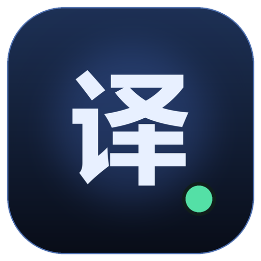
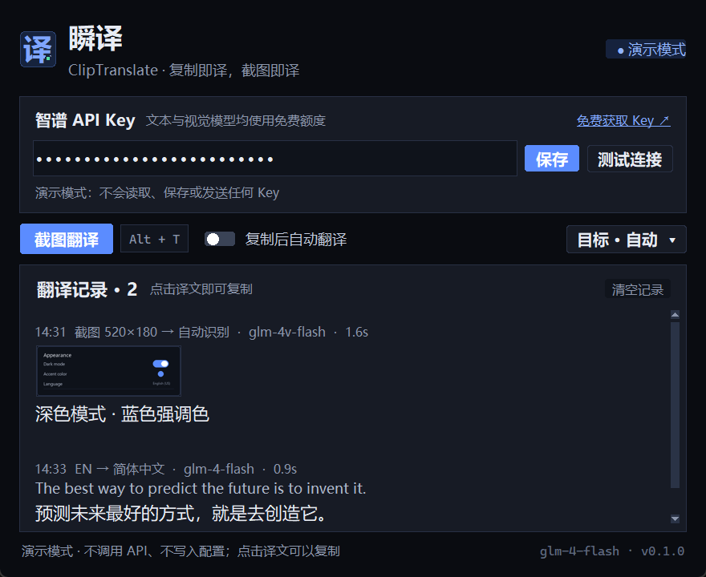

<div align="center">



# 瞬译 ClipTranslate

**复制即译，截图即译。** 一个轻量的 Windows 桌面实时翻译工具。

[功能](#功能) · [快速开始](#快速开始) · [使用说明](#使用说明) · [打包 exe](#打包-exe) · [实现原理](#实现原理) · [隐私](#隐私与数据)

</div>



> 上图由 `python -m cliplens --demo` 生成，使用内置示例，不会调用 API。

## 功能

| 能力 | 说明 |
| --- | --- |
| 剪贴板实时翻译 | 后台监听剪贴板，复制文字后自动翻译；相同内容只处理一次 |
| 截图 OCR 翻译 | 按 `Alt+T` 或点击按钮，拖拽框选屏幕区域，识别图中文字并翻译 |
| 自动语言方向 | 中文自动译成英文，其他语言自动译成简体中文；也可手动指定中/英/日/韩 |
| 智谱免费模型 | 文本使用 `glm-4-flash`，图片使用 `glm-4v-flash`，无需本地显卡 |
| 翻译历史 | 保留本次运行的记录，点击译文即可复制；支持截图缩略图 |
| 深色原生界面 | 纯 Tkinter，无 Electron / 浏览器内核；Windows 11 深色标题栏 |
| 本机配置 | API Key 与偏好保存在本机，不经过任何第三方服务器 |
| 可打包 | 一条 PyInstaller 命令生成单文件 `ClipTranslate.exe` |

## 快速开始

### 1. 环境要求

- Windows 10 / 11
- Python 3.10 或更高版本（已在 Python 3.14 上测试）
- 一个智谱开放平台的 API Key（有免费额度）

安装 Python 时请勾选 **Add Python to PATH**。Tkinter 随官方 Python 一起安装，无需单独安装。

### 2. 安装依赖

在项目目录打开 PowerShell：

```powershell
python -m pip install -r requirements.txt
```

也可以安装为可编辑包（会注册 `cliplens` 命令）：

```powershell
python -m pip install -e .
```

### 3. 配置 API Key

1. 打开 [智谱开放平台 API Keys](https://open.bigmodel.cn/usercenter/apikeys) 并登录。
2. 创建一个 API Key 并复制。
3. 启动应用，把 Key 粘贴到顶部输入框，点击 **保存**，再点 **测试连接**。

也可以先启动预览模式查看界面：

```powershell
python -m cliplens --demo
```

### 4. 启动

```powershell
python -m cliplens
```

或者：

```powershell
python run.py
```

## 使用说明

### 剪贴板翻译

1. 确认顶部状态为 **监听中**，且“复制后自动翻译”开关已打开。
2. 在浏览器、Word、聊天软件等任意位置复制一段文字。
3. 应用会自动翻译，并追加到“翻译记录”中。
4. 点击任意一条译文即可复制；复制动作不会再次触发翻译。

关闭开关只会暂停剪贴板监听，`Alt+T` 截图翻译仍然可用。

### 截图翻译

1. 按 `Alt+T`，或点击 **截图翻译**。
2. 屏幕变暗后，按住鼠标左键拖拽框选区域。
3. 松开鼠标，应用会截取该区域并调用视觉模型做 OCR + 翻译。
4. 按 `Esc` 或点鼠标右键可取消框选。

如果全局快捷键注册失败（部分安全软件或权限设置会拦截键盘钩子），仍可点击按钮截图；必要时以管理员身份运行。

### 目标语言

右上角的 **目标 · 自动** 菜单支持：

- 自动：中文 → 英文，其他语言 → 简体中文
- 简体中文 / English / 日本語 / 한국어：强制翻译为指定语言

所有设置修改后立即保存，下次启动继续生效。

### 配置文件

默认位置：

```text
%APPDATA%\ClipTranslate\config.json
```

可通过环境变量 `CLIPTRANSLATE_CONFIG` 指定其他路径，通过 `ZHIPUAI_API_KEY` 提供 Key（界面中保存的 Key 优先）。

## 打包 exe

```powershell
python -m pip install pyinstaller
pyinstaller --noconfirm --clean --onefile --windowed `
  --name ClipTranslate `
  --icon cliplens/assets/icon.ico `
  --add-data "cliplens/assets;cliplens/assets" `
  run.py
```

生成文件：`dist\ClipTranslate.exe`。

说明：

- `--onefile` 首次启动会解压到临时目录，速度略慢；追求启动速度可去掉它，改用目录形式。
- 打包后不需要目标电脑安装 Python，但仍需要网络和 API Key。
- 如果使用自定义图标，请保持 `cliplens/assets/icon.ico` 的路径，或在命令中替换。

## 实现原理

```text
剪贴板 ── pyperclip 轮询 ──┐
                          ├─ 主线程事件队列 ── Tkinter UI ── 翻译记录
Alt+T / 截图按钮 ── 框选 ──┘          │
                                      ├─ 文本：glm-4-flash
                                      └─ 图片：glm-4v-flash（OCR + 翻译）
```

几个关键设计：

- **所有网络请求都在 daemon 线程中执行**，Tkinter 主线程只消费队列，窗口不会卡死。
- **剪贴板轮询线程不碰 Tk 控件**，避免 Tk 的线程安全问题。
- **截图前先抓取整个虚拟桌面**，再显示压暗的覆盖层，因此最终裁剪结果不会包含选框 UI。
- **请求直连 REST API**，不依赖厂商 SDK，减少依赖并兼容较新的 Python 版本。
- **自动语言判断**使用轻量启发式（假名、谚文、汉字、拉丁字母），不额外调用模型。
- **提示词只要求输出译文**，并显式防止把待翻译文本里的指令当作系统指令执行。

### 项目结构

```text
clip-translate/
├─ cliplens/
│  ├─ app.py          # 入口、DPI、AppUserModelID
│  ├─ ui.py           # 主窗口与交互
│  ├─ translator.py   # 智谱 REST 客户端、语言判断、提示词
│  ├─ clipboard.py    # 剪贴板轮询、去重、忽略列表
│  ├─ capture.py      # 全屏截图、框选覆盖层、图片压缩
│  ├─ hotkey.py       # 全局快捷键（尽力而为）
│  ├─ config.py       # 配置读写
│  ├─ widgets.py      # 手绘圆角按钮 / 开关 / 状态胶囊
│  ├─ resources.py    # 源码与 PyInstaller 资源路径
│  └─ assets/         # 应用图标
├─ tests/             # pytest 单元测试
├─ tools/             # 图标与截图生成脚本
├─ docs/app.png       # README 截图
├─ run.py             # 源码 / PyInstaller 入口
├─ pyproject.toml
└─ requirements.txt
```

## 测试

```powershell
python -m pytest -q
```

测试覆盖配置读写与容错、语言判断、请求构造与错误映射、429 重试、内容解析、剪贴板去重/忽略、图片缩放与 JPEG 回退。

GitHub Actions 会在 Windows 上对 Python 3.10 / 3.12 / 3.13 运行同一套测试。

## 隐私与数据

- API Key 保存在本机 `config.json` 中（当前版本为明文 JSON）。请勿把该文件提交到 Git 或发给他人；共用电脑建议改用 `ZHIPUAI_API_KEY` 环境变量，或使用后清除。
- 只有在你复制文字、触发截图翻译或点击“测试连接”时，应用才会把对应文本 / 图片发送到智谱 API。
- 应用没有遥测、统计或自动更新；翻译记录只存在于内存中，关闭窗口即清空。
- 剪贴板轮询只在应用运行且开关打开时进行，不会读取图片、文件等非文本内容。
- 使用第三方 API 时，文本与图片的处理还受智谱开放平台的服务条款与隐私政策约束。

## 常见问题

**Q：`Alt+T` 没有反应？**
A：`keyboard` 库通过系统键盘钩子注册快捷键，部分安全软件会拦截。可以先用界面按钮；或以管理员身份运行。状态栏会显示注册失败的原因。

**Q：提示 401 / 403？**
A：Key 无效、被删除或没有模型权限。重新生成 Key 后点“测试连接”。

**Q：提示 429？**
A：请求过于频繁或免费额度用尽。稍等再试，或在智谱控制台查看额度。

**Q：截图位置偏移 / 发黑？**
A：应用启动时已开启 Per-Monitor DPI 感知。若使用混合缩放的多显示器，请把窗口和选区放在同一块屏幕上再试；仍异常时欢迎提 Issue 并附上显示器缩放比例。

**Q：能换模型吗？**
A：可以。编辑 `config.json` 中的 `text_model` / `vision_model`，填入账号可用的模型名，重启应用即可。默认值针对免费额度。

**Q：为什么不用本地离线模型？**
A：这个项目的目标是“装好即用、不占显存”。本地 OCR + 翻译模型体积和硬件要求都高得多；如果你需要完全离线，可以把 `translator.py` 替换成自己的实现。

## License

[MIT](LICENSE)
